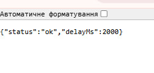
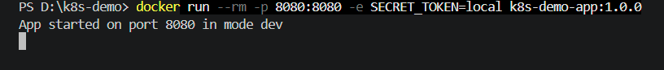
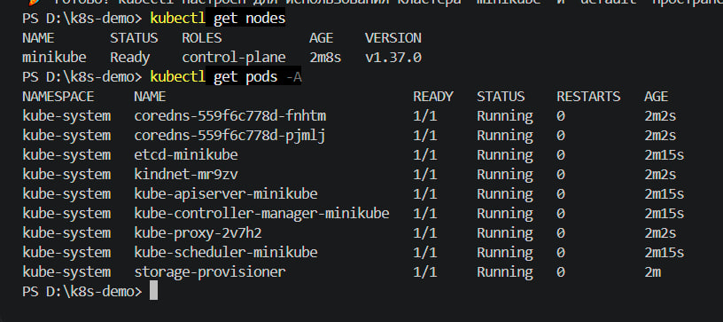

# Практична робота №10

## Тема: Docker та Kubernetes

**Учасники:** Ріта та Юля.

## 1. Локальний запуск Node.js

Встановлено залежності та запущено Node.js-застосунок на порту 8080.

Команди:

`npm.cmd install`

`npm.cmd run dev`

Перевірено шість API-маршрутів:

1. `/api/status` — статус `ok`, режим `dev`, версія `1.0.0`.
2. `/api/items?filter=a` — повертає товар `Item A`.
3. `/api/slow` — відповідь із затримкою 2000 мс.
4. `/api/error` — повідомлення `No error`.
5. `/healthz` — відповідь `ok`.
6. `/ready` — статус `ready`.

**Результат:** усі маршрути працюють коректно.
### Скриншоти перевірки API

**1. Перевірка `/api/status`**

**2. Перевірка `/api/items?filter=a`**

**3. Перевірка `/api/slow`**

**4. Перевірка `/api/error`**

**5. Перевірка `/healthz`**

**6. Перевірка `/ready`**

## 2. Робота з Docker

Створено Docker-образ:

`docker build -t k8s-demo-app:1.0.0 .`

Перевірено наявність образу:

`docker images`

Запущено Docker-контейнер:

`docker run --rm -p 8080:8080 -e SECRET_TOKEN=local k8s-demo-app:1.0.0`

Отримано повідомлення:

`App started on port 8080 in mode dev`

Перевірено маршрути `/api/status` та `/healthz`.

**Результат:** Docker-образ створено, контейнер успішно працює.

### Скриншоти роботи з Docker

**1. Перевірка створеного Docker-образу**

Команда `docker images` підтверджує наявність образу `k8s-demo-app:1.0.0`.

**2. Запуск Docker-контейнера**

Контейнер успішно запущено на порту 8080 у режимі `dev`.

**3. Перевірка API**

Перевірено маршрути `/api/status` та `/healthz`. Застосунок повертає успішні відповіді.

## 3. Запуск Kubernetes через Minikube

Локальний кластер запущено командою:

`minikube start --memory=4096 --cpus=2 --driver=docker`

Перевірено стан кластера:

`kubectl get nodes`

`kubectl get pods -A`

Отримано результати:

- Вузол `minikube` — `Ready`.
- Версія Kubernetes — `v1.37.0`.
- Усі 8 системних подів — `Running`.
- Кількість перезапусків — 0.

**Результат:** Kubernetes-кластер успішно працює.

### Скриншот перевірки Kubernetes

Виконано команди `kubectl get nodes` та `kubectl get pods -A`.

Результати перевірки:
- Вузол `minikube` має статус `Ready`.
- Усі 8 системних подів працюють у стані `Running`.
- Кількість перезапусків — 0.

### Перевірка профілю та контексту Kubernetes

Виконано команди:

`minikube profile list`

`kubectl config get-contexts`

`kubectl config current-context`

Результати перевірки:

- Активний профіль: `minikube`.
- Драйвер: `docker`.
- Статус кластера: `OK`.
- Версія Kubernetes: `v1.37.0`.
- Кількість вузлів: 1.
- Поточний контекст kubectl: `minikube`.

Контекст налаштований правильно, кластер готовий до розгортання застосунку.

## 4. Розгортання застосунку в Kubernetes

Розділ буде доповнено після виконання Kubernetes-ресурсів.

## 5. Перевірка ConfigMap і health probes

Розділ буде доповнено після перевірки зміни `APP_MODE` з `dev` на `prod`, readiness та liveness probes.

## 6. Контрольні питання

Розділ буде доповнено відповідно до завдання практичної роботи.

## Висновок

Під час практичної роботи успішно запущено Node.js-застосунок, перевірено його API, створено Docker-образ та запущено контейнер. Також налаштовано локальний Kubernetes-кластер Minikube і перевірено його працездатність.