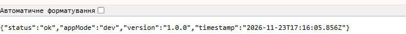
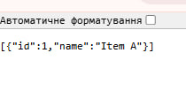
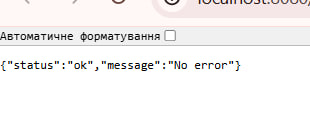
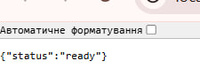
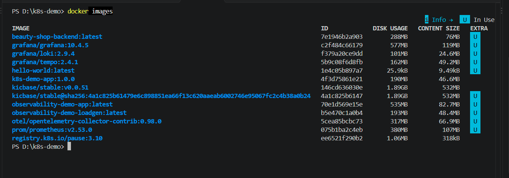
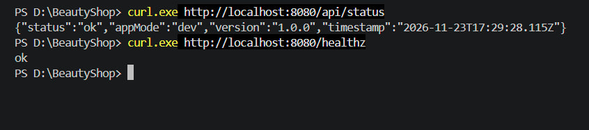
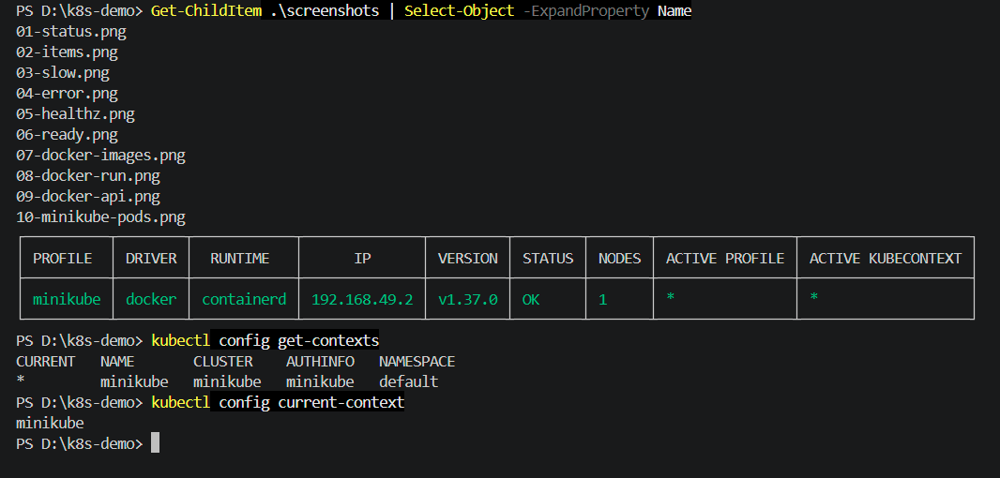

# Практична робота №10

## Тема: Docker та Kubernetes

**Учасники:** Ріта та Юля.

## 1. Локальний запуск Node.js

Встановлено залежності та запущено Node.js-застосунок на порту 8080.

Команди:

`npm.cmd install`

`npm.cmd run dev`

Перевірено шість API-маршрутів:

1. `/api/status` — статус `ok`, режим `dev`, версія `1.0.0`.
2. `/api/items?filter=a` — повертає товар `Item A`.
3. `/api/slow` — відповідь із затримкою 2000 мс.
4. `/api/error` — повідомлення `No error`.
5. `/healthz` — відповідь `ok`.
6. `/ready` — статус `ready`.

**Результат:** усі маршрути працюють коректно.

### Скриншоти перевірки API

**1. Перевірка `/api/status`**



**2. Перевірка `/api/items?filter=a`**



**3. Перевірка `/api/slow`**


**4. Перевірка `/api/error`**



**5. Перевірка `/healthz`**


**6. Перевірка `/ready`**



## 2. Робота з Docker

Створено Docker-образ:

`docker build -t k8s-demo-app:1.0.0 .`

Перевірено наявність образу:

`docker images`

Запущено Docker-контейнер:

`docker run --rm -p 8080:8080 -e SECRET_TOKEN=local k8s-demo-app:1.0.0`

Отримано повідомлення:

`App started on port 8080 in mode dev`

Перевірено маршрути `/api/status` та `/healthz`.

**Результат:** Docker-образ створено, контейнер успішно працює.

### Скриншоти роботи з Docker

**1. Перевірка створеного Docker-образу**

Команда `docker images` підтверджує наявність образу `k8s-demo-app:1.0.0`.



**2. Запуск Docker-контейнера**

Контейнер успішно запущено на порту 8080 у режимі `dev`.


**3. Перевірка API**

Перевірено маршрути `/api/status` та `/healthz`. Застосунок повертає успішні відповіді.



## 3. Запуск Kubernetes через Minikube

Локальний кластер запущено командою:

`minikube start --memory=4096 --cpus=2 --driver=docker`

Перевірено стан кластера:

`kubectl get nodes`

`kubectl get pods -A`

Отримано результати:

- Вузол `minikube` — `Ready`.
- Версія Kubernetes — `v1.37.0`.
- Усі 8 системних подів — `Running`.
- Кількість перезапусків — 0.

**Результат:** Kubernetes-кластер успішно працює.

### Скриншот перевірки Kubernetes

Виконано команди `kubectl get nodes` та `kubectl get pods -A`.

Результати перевірки:

- Вузол `minikube` має статус `Ready`.
- Усі 8 системних подів працюють у стані `Running`.
- Кількість перезапусків — 0.


### Перевірка профілю та контексту Kubernetes

Виконано команди:

`minikube profile list`

`kubectl config get-contexts`

`kubectl config current-context`

Результати перевірки:

- Активний профіль: `minikube`.
- Драйвер: `docker`.
- Статус кластера: `OK`.
- Версія Kubernetes: `v1.37.0`.
- Кількість вузлів: 1.
- Поточний контекст kubectl: `minikube`.

Контекст налаштований правильно, кластер готовий до розгортання застосунку.



## 4. Розгортання застосунку в Kubernetes

Розділ буде доповнено після виконання Kubernetes-ресурсів.

## Розділ 4. Розгортання Kubernetes-ресурсів та доступ через Service

### 4.1. Застосування маніфестів та перевірка ресурсів

Після застосування маніфестів (`namespace.yaml`, `configmap.yaml`, `secret.yaml`, `deployment.yaml`, `service.yaml`) у просторі імен `k8s-demo` було перевірено стан усіх створених об'єктів:

````text
NAME                                READY   UP-TO-DATE   AVAILABLE   AGE
deployment.apps/k8s-demo-api        2/2     2            2           5m49s

NAME                                           DESIRED   CURRENT   READY   AGE
replicaset.apps/k8s-demo-api-5c45559886        0         0         0       5m49s
replicaset.apps/k8s-demo-api-64d596855b        2         2         2       83s

NAME                                    READY   STATUS    RESTARTS   AGE
pod/k8s-demo-api-64d596855b-q7f22       1/1     Running   0          69s
pod/k8s-demo-api-64d596855b-vf9cx       1/1     Running   0          83s

NAME                   TYPE        CLUSTER-IP      EXTERNAL-IP   PORT(S)   AGE
service/k8s-demo-api   ClusterIP   10.103.91.37    <none>        80/TCP    5m44s

### 4.2. Доступ до сервісу через Service та kubectl port-forward
Для перевірки роботи застосунку в кластері було запущено прокидання порту `kubectl port-forward svc/k8s-demo-api -n k8s-demo 8080:80` та виконано тестові запити[cite: 45, 99]:

```json
{"status":"ok","appMode":"prod","version":"1.0.0","timestamp":"2026-11-24T20:38:02.246Z"}
[{"id":1,"name":"Item A"},{"id":2,"name":"Item B"},{"id":3,"name":"Item C"}]

## 5. Перевірка ConfigMap і health probes
Markdown
## Розділ 5. Конфігурація через ConfigMap та діагностика Health Checks

### 5.1. Перевірка роботи ConfigMap та оновлення `APP_MODE`

Початково у `ConfigMap` (`k8s-demo-config`) та всередині запущеного Pod-а було встановлено значення `APP_MODE=prod`[cite: 8]. Після зміни параметра у файлі `k8s/configmap.yaml` на `APP_MODE: "dev"` та застосування `kubectl apply -f k8s/configmap.yaml` сам об'єкт `ConfigMap` у кластері оновився, але всередині вже запущеного Pod-а залишилося попереднє значення `APP_MODE=prod`:

```text
APP_MODE: dev
APP_MODE=prod

### 5.2. Діагностика Health Checks та логів
Перевірка `kubectl describe pod` та `kubectl logs` підтвердила коректну роботу проб:

```text
App started on port 8080 in mode dev
[2026-11-24T20:48:41.538Z] GET /ready 503 12ms
[2026-11-24T20:48:45.394Z] GET /healthz 200 1ms
[2026-11-24T20:48:46.520Z] GET /ready 200 1ms
```

* **Readiness Probe (`/ready`):** блокує трафік на Pod під час ініціалізації (статус `503`) і підключає його до `Service` після готовності (`200`).
* **Liveness Probe (`/healthz`):** контролює працездатність процесу (`200`) та перезапускає контейнер у разі зависання.


## 6. Контрольні питання

1. **Pod vs Deployment:** `Pod` — ефемерна одиниця запуску контейнерів, яка не відновлюється самостійно після збою. `Deployment` керує репліками через `ReplicaSet`, забезпечує самовідновлення та оновлення без простою (Rolling Update).
2. **Service (ClusterIP):** надає постійну внутрішню IP-адресу та DNS-ім'я для динамічних Pod-ів, чиї IP змінюються при перестворенні, і балансує між ними трафік.
3. **ConfigMap vs Secret:** `ConfigMap` зберігає відкриті налаштування (наприклад, `APP_MODE`), а `Secret` — конфіденційні дані (паролі, токени) у Base64 з обмеженням прав доступу.
4. **Liveness та Readiness probes:** `Readiness` захищає користувачів від запитів до ще не готового Pod-а, а `Liveness` автоматично перезапускає завислі контейнери.

## Висновок

Під час практичної роботи успішно запущено Node.js-застосунок, перевірено його API, створено Docker-образ та запущено контейнер. Також налаштовано локальний Kubernetes-кластер Minikube і перевірено його працездатність.
````
